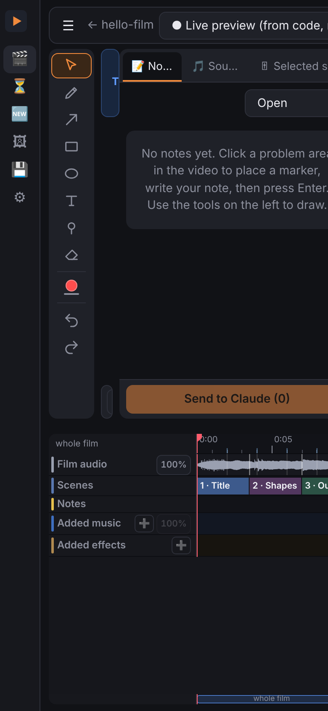
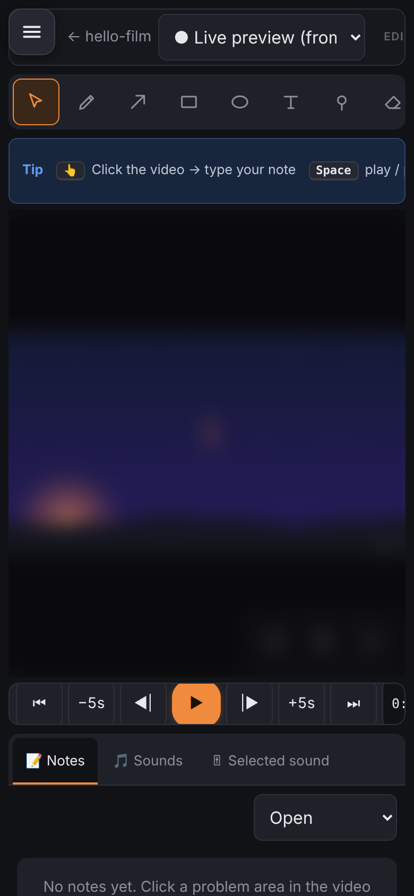
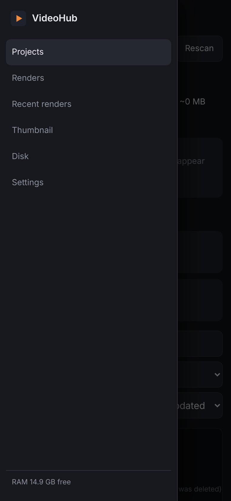
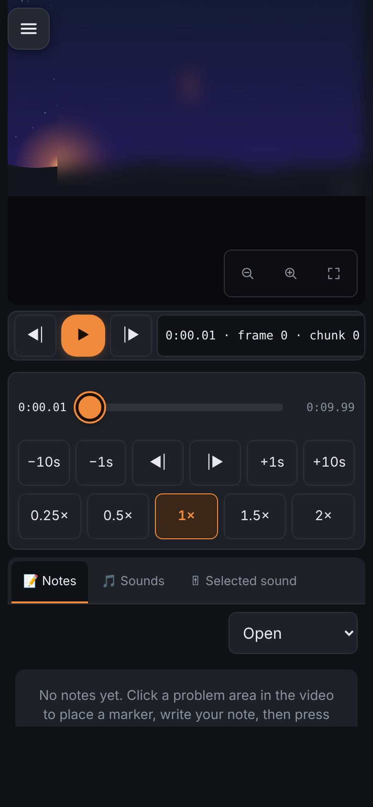
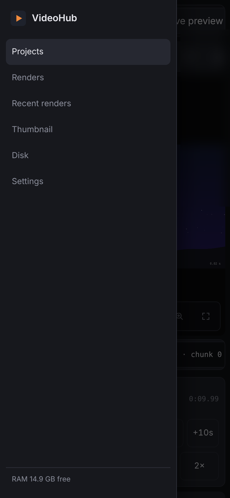
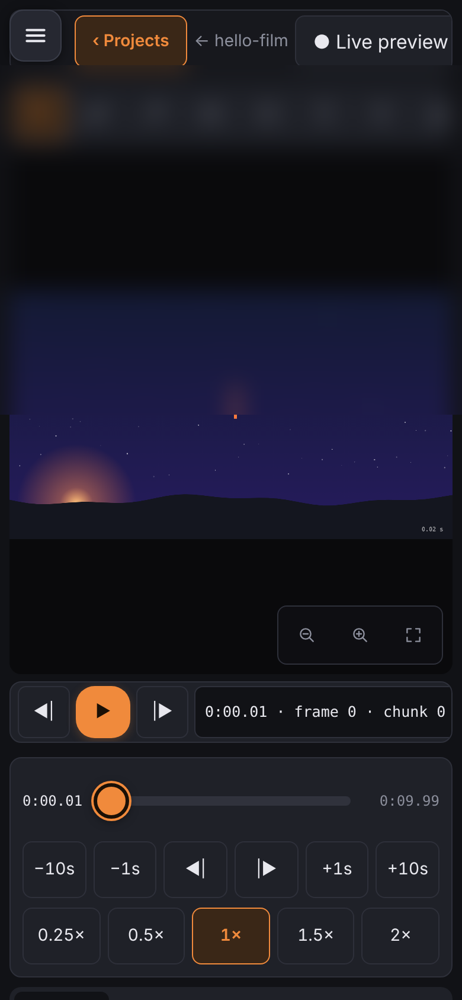
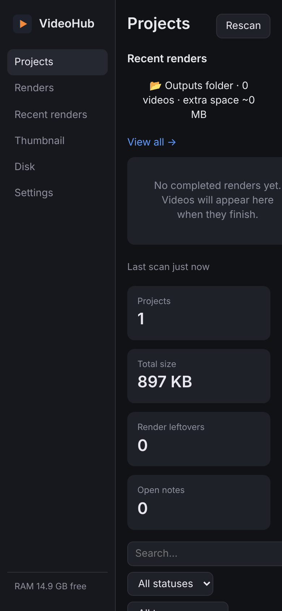
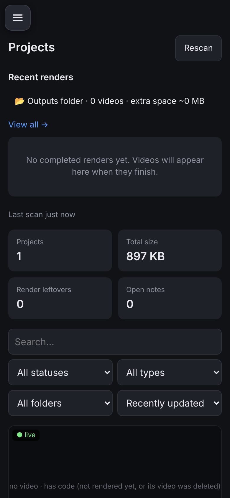

# VideoHub for Claude Code on the Cloud — Mobile-friendly

**Fork of [TensaikunYT/Videohub](https://github.com/TensaikunYT/Videohub)** (MIT). All credit for VideoHub itself (the review studio, live preview, notes, render queue and MCP tools) goes to its creator, TensaikunYT. The original documentation is kept in [docs/UPSTREAM-README.md](docs/UPSTREAM-README.md).

## What this fork adds

VideoHub was built for an agent running on the same PC. This fork makes it a review tool for videos that a **Claude Code session in the cloud** builds with Remotion, HyperFrames or plain code: the session pushes a project to a git repo, VideoHub runs in Docker on your PC or server, you watch and write notes in a browser or on your phone, and the notes travel back through git.

| Area | Upstream | This fork |
|---|---|---|
| Where it runs | Local PC, same machine as the agent | Docker image (`deploy/`) on a PC or server, reachable from a phone through a Cloudflare Tunnel |
| Cloud agent | Not supported | Two-way git sync: `films/<name>/` in, `notes/<name>/` out; skill in `skill/videohub-cloud/` |
| Video seeking in the live preview | No byte ranges, mp4 clips can stay on frame 1 | HTTP Range (206) built into `server/live.js` |
| Host names and public link | Loopback only | `config.allowedHosts`, `config.publicUrl` (adapted from DecafCoding/Videohub) |
| Stopping a render | Chrome can be relaunched by a render that ignores SIGTERM | Root frozen first (from jorgepvenegas/Videohub) |
| Frameworks | Plain code | Adapters for Remotion and HyperFrames (`adapters/`) |
| Access control | None (loopback) | Password gateway, plus Cloudflare Access for the tunnel |
| Phone and tablet | Desktop layout only: the sidebar takes half the screen and the player is cut off | Responsive layout below 820px: hamburger menu, sidebar drawer, full-width player, touch scrub bar with jump and speed buttons, finger-sized controls |

```
Claude cloud session
   |  git push films/<name>/
   v
git review repo  <---------------------------+
   |  pulled every 60 s                      | notes/<name>/ pushed back
   v                                         |
Docker: VideoHub + password gateway ---------+
   |  Cloudflare Tunnel + Access
   v
Browser / phone: watch, draw, write notes
```

## What's new: mobile-friendly

Reviewing from a phone was the main reason to put VideoHub behind a tunnel, but the upstream UI is desktop-only: on a phone the fixed sidebar takes about half the screen and the player, the tools and the notes are cut off on the right.

This fork adds a small responsive layer, `ui/mobile.css` and `ui/mobile.js`, loaded from `ui/index.html`. VideoHub's own code is unchanged.

- **Below 820px wide:** the sidebar becomes a drawer behind a hamburger button, with a dark backdrop. It closes on a backdrop tap, on choosing a link, on Escape and when the screen changes.
- **Content:** takes the full width. The player is full width, tables scroll inside themselves, and there is no horizontal page scroll.
- **Controls:** buttons and inputs are at least 44px tall, so they are easy to tap. Inputs use 16px text, so iPhone does not zoom in.
- **Every screen was adjusted:** Projects, the project page, Review and notes (tools in one scrolling row, player, notes and timeline in one column), Renders, Recent renders, the Thumbnail studio and its editor, Disk and Settings.
- **Desktop:** above 820px the page is exactly as before (checked side by side at 1280px).
- **Touch control bar on the review screen:** a full-width scrub bar with a large thumb (drag or tap to seek without playing, with current time and length), jump buttons (−10s, −1s, one frame back, one frame forward, +1s, +10s) and speed buttons (0.25×, 0.5×, 1×, 1.5×, 2×). It drives VideoHub's existing transport controls, so there is no duplicated playback logic. The original timeline stays where it was.
- **Back to projects:** a prominent "‹ Projects" button in the review screen's top bar, and the drawer opens on every screen, including review.

Tested with Playwright at 390px and 1280px, with touch emulation in Chromium, and on a real phone through the Cloudflare Tunnel.

| Review screen, before | Review screen, after | Drawer open |
|---|---|---|
|  |  |  |

| Touch control bar | Drawer on the review screen | Back to projects |
|---|---|---|
|  |  |  |

| Projects, before | Projects, after |
|---|---|
|  |  |

To update an existing install: `git pull`, then `docker compose -f docker-compose.local.yml up -d --build` in `deploy/`.

## Quick start (Windows PC with Docker Desktop)

1. Create a **private** GitHub repo for reviews (for example `my-video-reviews`) and a fine-grained token with *Contents: read and write* on that repo only.
2. Clone this fork, then:
   ```
   cd deploy
   copy .env.example .env
   ```
   Edit `.env`: set `VH_USER`, a `VH_PASS` of 12+ characters, `FILMS_REPO` (the review repo URL) and `GIT_TOKEN`.
3. Start it: `docker compose -f docker-compose.local.yml up -d --build`
4. Open http://127.0.0.1:8080 and log in. The bundled `hello-film` example should be listed.
5. Tell your Claude Code session to use the `videohub-cloud` skill (copy `skill/videohub-cloud/` into the session's skills, or point it to this repo) and to push films to `films/<name>/` of the review repo.

Line endings: `deploy/.gitattributes` forces LF for scripts. If you edit them on Windows, keep LF.

## Server (Coolify or any Docker host)

Use `deploy/docker-compose.yml` (build context is the repository root). Set `VH_USER`, `VH_PASS`, `FILMS_REPO`, `GIT_TOKEN`, and, if you serve it under your own name, `VH_ALLOWED_HOSTS=review.example.com` and `VH_PUBLIC_URL=https://review.example.com`. The service exposes port 8080 (the password gateway); put your reverse proxy in front of it. Persistent data is the `videohub-data` volume. `shm_size: 1gb` is needed for Chromium.

## Phone access (Cloudflare Tunnel + Access)

1. In Cloudflare Zero Trust, create a tunnel and a public hostname such as `review.example.com` pointing to `http://videohub:8080`.
2. Add a **Cloudflare Access** application for that hostname with a policy that allows only your email. Do not skip this: without it, only the gateway password protects the hub.
3. Put the tunnel token in `deploy/.env` as `TUNNEL_TOKEN` (the whole value, on one line), and set `VH_ALLOWED_HOSTS` / `VH_PUBLIC_URL` to your hostname.
4. `docker compose -f docker-compose.local.yml --profile tunnel up -d`

The tunnel runs with `--protocol http2` because many networks block QUIC, and the `cloudflared` image version is pinned in the compose file.

## Remotion

[adapters/remotion/](adapters/remotion/README.md): a generic bridge that wraps `@remotion/player` in VideoHub's page contract, a chunked renderer, and page templates. Known limitation: note pictures come out black for DOM/video pages (the marks and times are fine); the skill explains the workaround.

## HyperFrames

[adapters/hyperframes/](adapters/hyperframes/README.md): **experimental**, written from HyperFrames' documented `window.__hf.seek(time)` protocol; the README lists what to verify. Plain code videos need no adapter: see [adapters/plain/](adapters/plain/README.md).

## Security

- Anyone who can reach VideoHub can run commands through its job queue. Never expose port 8080 without the gateway password, and use Cloudflare Access for anything on the internet.
- The default install listens on `127.0.0.1` only. `allowedHosts` and `publicUrl` are read from `data/config.json` only (the Settings page cannot change them); VideoHub still rejects requests from other websites (`Sec-Fetch-Site`, `Origin`).
- The gateway compares the password in constant time and also rewrites `Host`/`Origin`/`Referer` to loopback as a fallback.
- Keep `GIT_TOKEN` scoped to the review repo, never commit `deploy/.env`, and keep the review repo private. Files in git must be under 100 MB.
- Chromium runs with `--no-sandbox` because the container is the sandbox: do not give the container more privileges than it has.

## Troubleshooting

| Symptom | Fix |
|---|---|
| Clips stay on the first frame | Needs HTTP Range; rebuild the image from this fork |
| Chromium exits at once in the container | `--no-sandbox` via `/etc/chromium.d` (already in `deploy/Dockerfile`) |
| `\r` or "not found" when starting | CRLF line endings; keep `eol=lf` (`deploy/.gitattributes`) and rebuild |
| Tunnel: invalid token | The token was cut when pasted; copy it whole |
| Tunnel never connects | QUIC blocked: use `--protocol http2` (already set) |
| Render is only 10 seconds long | `.videohub/project.json` was not synced; push it with the film |
| Audio out of sync | `?aoffset=` / `?offset=` on the preview URL, then store `offset` in `data.json` |
| Notes do not come back | Check `GIT_TOKEN` write access and `docker logs` |
| `npm test` fails `windows-safety.test.js` (clickable lifecycle entry points) | Present in the upstream commit this fork started from (it expects `open.vbs`/`open.ps1` to be absent) |

More in [skill/videohub-cloud/SKILL.md](skill/videohub-cloud/SKILL.md).

## Credits

- **[TensaikunYT/Videohub](https://github.com/TensaikunYT/Videohub)**: VideoHub itself (MIT).
- **[DecafCoding/Videohub](https://github.com/DecafCoding/Videohub)**: the allowed-hosts and public-link design (`server/lan.js`, `config.allowedHosts`, `config.publicUrl`, clipboard fallback), adapted here.
- **[jorgepvenegas/Videohub](https://github.com/jorgepvenegas/Videohub)**: the "stop render trees without relaunched orphans" fix, applied here.

License: MIT, see [LICENSE](LICENSE).
